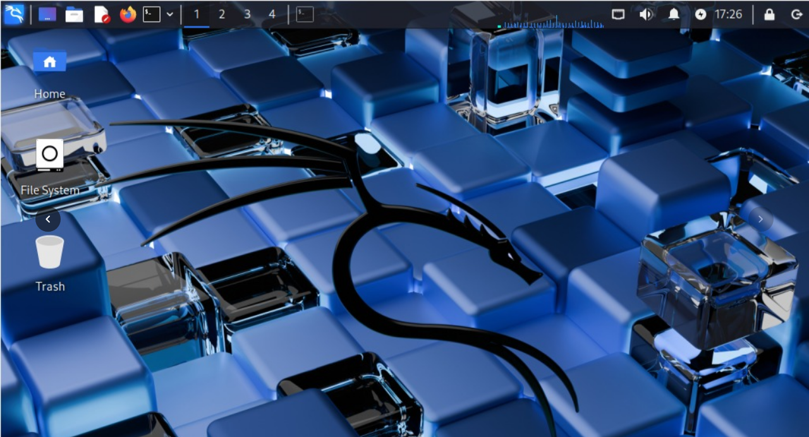
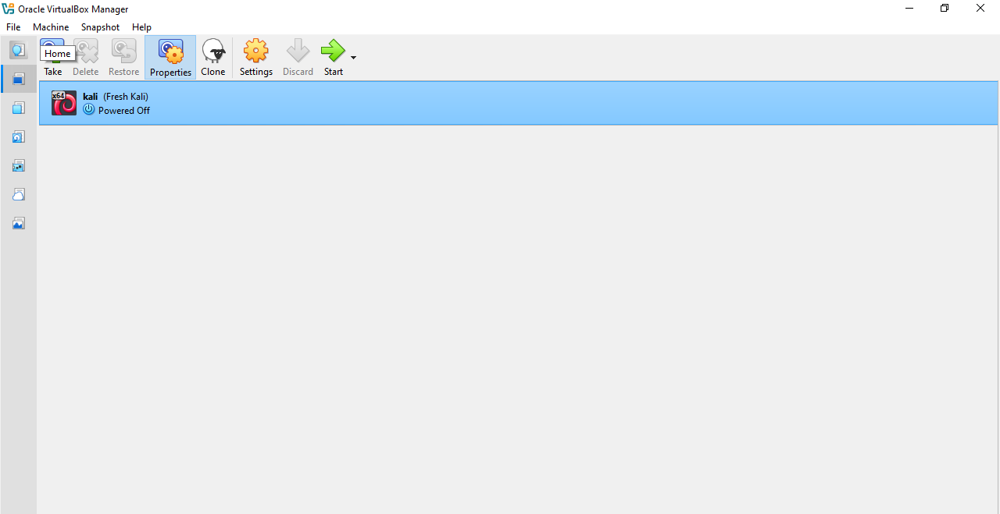
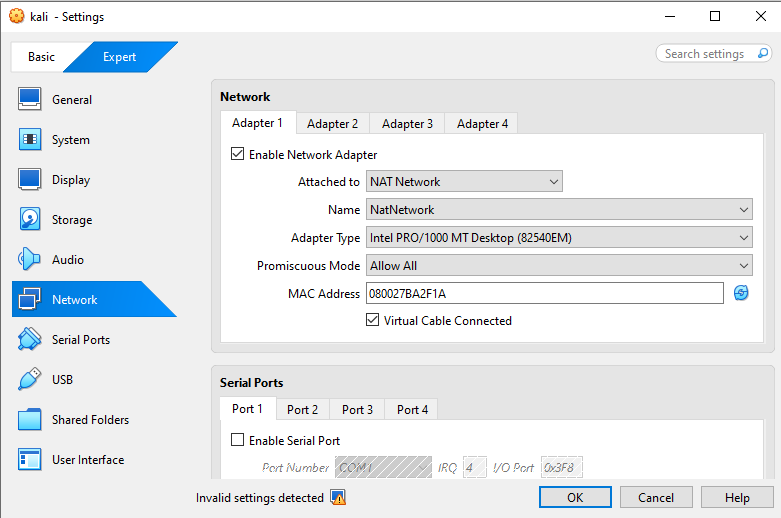
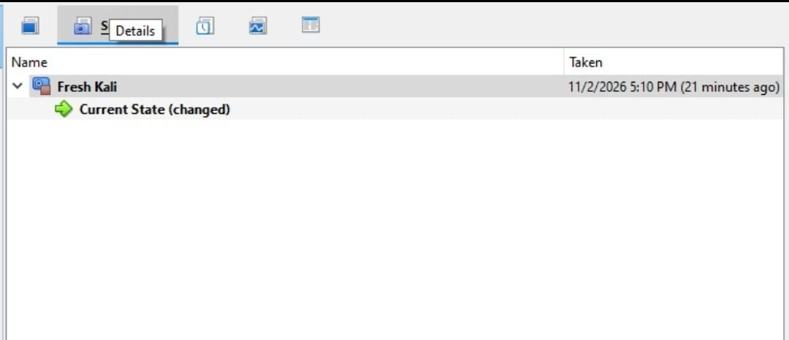

<div align="center">

# 🔐 Cybersecurity Lab Environment Setup

**Building an isolated virtual lab for penetration testing and ethical hacking practice**
</div>

<p align="center">
  
  
  
  
  
  
  
  
  
  
</p>

---

## 📌 Project Overview

In this project, I set up my own virtual lab for cybersecurity practice. I used VirtualBox and Kali Linux for this lab.

This project focuses on setting up a *virtual cybersecurity and penetration-testing laboratory* using VirtualBox and Kali Linux.
The purpose of the lab is to create a controlled environment where cybersecurity tools, network scanning, reconnaissance, vulnerability assessment, and other security-testing activities can be performed safely and repeatedly.

---

## 🎯 Objectives

My objectives for this lab are to:

- Install and configure VirtualBox.
- Install/import Kali Linux as a virtual machine.
- Create a private *NAT Network* for the cybersecurity lab.
- Configure network connectivity for Kali Linux.
- Assign a consistent IP address to the Kali VM.
- Verify network connectivity and DNS resolution.
- Take a clean VM snapshot for recovery.
- Document the complete setup process.
- Prepare the environment for future cybersecurity projects.

---

## 🛡️ Purpose of the Lab

I will use this lab only for learning.

In this lab I will practice:
- Network scanning
- Checking open ports
- Finding weaknesses in my own machines
- Learning security tools like Nmap

⚠️ **Important:** I will only test machines that belong to me. I will never test any real website or real system without permission.

---

## 🏗️ Lab Architecture



This is the main view of my lab in VirtualBox. Kali Linux is running inside VirtualBox on my Windows laptop, and it is connected to a private NAT Network.

---

## ⚙️ Lab Configuration

| Component | Configuration |
| ------------------ | ------------------ |
| Host OS | Windows |
| Hypervisor | VirtualBox 7.2 |
| Security OS | Kali Linux 2026.2 |
| Kali RAM | 2048 MB |
| Virtual Network | NAT Network |
| Network Name | NatNetwork |
| DHCP | Enabled |
| IPv6 | Disabled |

---

# 🪜 Lab Setup Procedure

## Step 1. Install VirtualBox

First, I downloaded VirtualBox from its official website and installed it on my laptop. VirtualBox is a hypervisor, it helps me run another operating system inside my Windows.

After installation, I opened VirtualBox and checked that it was working properly.



## Step 2. Create the NAT Network

Then I created a private network for my lab. For this, I went to VirtualBox Tools > Network Manager and created a new NAT Network.

I named it NatNetwork and enabled DHCP so machines in the lab can get IP automatically.



I selected NAT Network and not simple NAT, because in NAT Network, all the machines in the same lab can talk to each other. In future when I add a target machine, it will also connect to this same network and I will be able to scan it from Kali.

## Step 3. Import Kali Linux

After that, I downloaded Kali Linux for VirtualBox from the official Kali website and imported it in VirtualBox.

Then I opened the settings of Kali and changed its network setting:

```text
Adapter 1
Attached to: NAT Network
Network Name: NatNetwork
Adapter Type: Intel PRO/1000 MT Desktop
RAM: 2048 MB
```

## Step 4. Start Kali and Check Network

After that, I started Kali Linux and opened the terminal to check its network.

I ran this command:

```bash
ip a
```

This showed me that Kali got an IP from the NAT Network, which means Kali is connected to my private lab network.

## Step 5. Test Internet Connection

Then I test the internet connection inside the Kali with this command:

```bash
ping -c 4 8.8.8.8
```

I got 0% packet loss, which means the internet is working properly inside kali.

## Step 6. Test DNS Resolution

Then I tested DNS to check if names are resolving correctly in Kali.

I ran this command:

```bash
ping -c 4 google.com
```

Google replied successfully, which means DNS is also working in my lab.

## Step 7. Take a Clean Snapshot

After all the checks, I took a clean snapshot of Kali in VirtualBox for recovery.

For this, I opened the Snapshots option of Kali in VirtualBox and took a new snapshot with a clean state, so in future if anything breaks, I can restore Kali to this working state.



---

## ✅ Conclusion

My lab is now ready. Kali Linux is running inside VirtualBox and connected to a private NAT Network with internet access.

In the future, I will add a target machine to this same network and scan it from Kali.

---

## 💡 What I Learned From This Lab

From this lab, I learned how to install VirtualBox and import Kali Linux in it.

I learned how to create a private NAT Network and connect Kali to it.

I learned how to check the network in Kali using the terminal and how to test internet and DNS.

I also learned how to take a snapshot, so I can restore my lab if anything goes wrong.

Check out my Linkedin Post Here:
https://www.linkedin.com/posts/aisha-khan-082446376_networkwalks-cybersecurity-kalilinux-activity-7523710162847842304-EJuf?utm_source=social_share_send&utm_medium=android_app&rcm=ACoAAFz4POIBuzLy4HLMi1c6CZ4TJx4PEOMETqc&utm_campaign=copy_link
